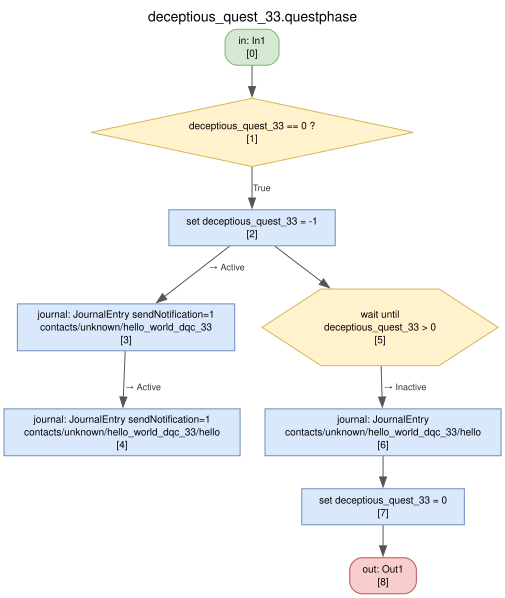

# test-mod-hello-world-dqc-33

Minimal test mod: when V enters the H10 apartment, the phone gets a text message saying "Hello world!".

It is a [Deceptious Quest Core](https://mod.io/g/cyberpunk-2077/m/deceptious-quest-core2) (DQC) slot mod and needs DQC installed. Purpose: prove the whole pipeline (author, build, load, DQC detection, journal message) before building a real framework on it.

> [!IMPORTANT]
> **Disclaimer:** This is an unofficial fan work and is not approved/endorsed by CD PROJEKT RED.

> [!WARNING]
> **Slot 33 is borrowed.** DQC slots belong to DQC's author, and slot 33 is unused today. It is used here for local testing only. Ask the author for a reserved slot before publishing; the mod must not go public on slot 33 without their OK.

Status: works (2026-10-25), installed locally in the game's `archive/pc/mod/`. See [PLAN.md](PLAN.md).

```sh
tools/build-mod.sh mods/test-mod-hello-world-dqc-33   # -> build/test-mod-hello-world-dqc-33/*.zip
```

## How it hooks in

DQC checks each slot when V enters the H10 apartment. If the slot's mod is missing, DQC waits until V is inside the slot's trigger area, so a mod installed later starts as soon as a save loads. This mod implements DQC's slot interface for slot 33 with its own files:

| Piece | Value |
|---|---|
| Slot phase (our file, at the path DQC starts) | `base\quest\deceptious_quests\deceptious_quest_33.questphase` |
| "Installed" marker DQC checks for | a trigger area node `#deceptious_qc_33` covering the whole map, in an always-loaded world sector |
| Slot fact | `deceptious_quest_33`: `0` free, `-1` active, `1` reset requested from DQC's phone menu |

No DQC files are copied or modified. DQC's phone list will show slot 33 without a name, since slot names live in DQC.

The text comes from the vanilla "unknown number" contact, so the mod defines no contact of its own.

## Slot phase



Regenerate after changing `build.py`:

```sh
tools/build-mod.sh mods/test-mod-hello-world-dqc-33
uv run tools/questgraph.py build/test-mod-hello-world-dqc-33/json/base/quest/deceptious_quests/deceptious_quest_33.questphase.json -o mods/test-mod-hello-world-dqc-33/slot_phase.svg
```
